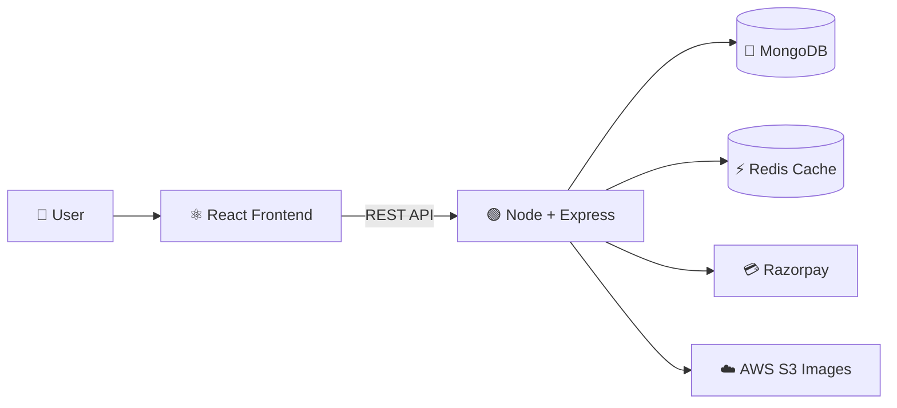
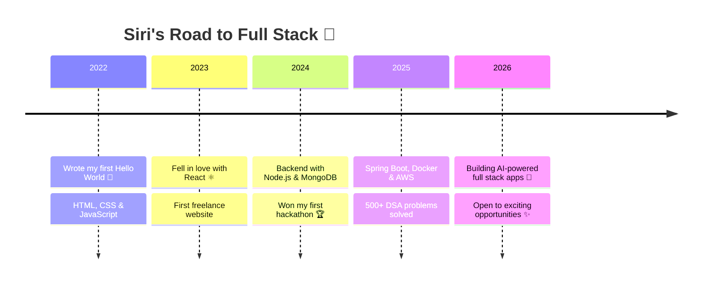
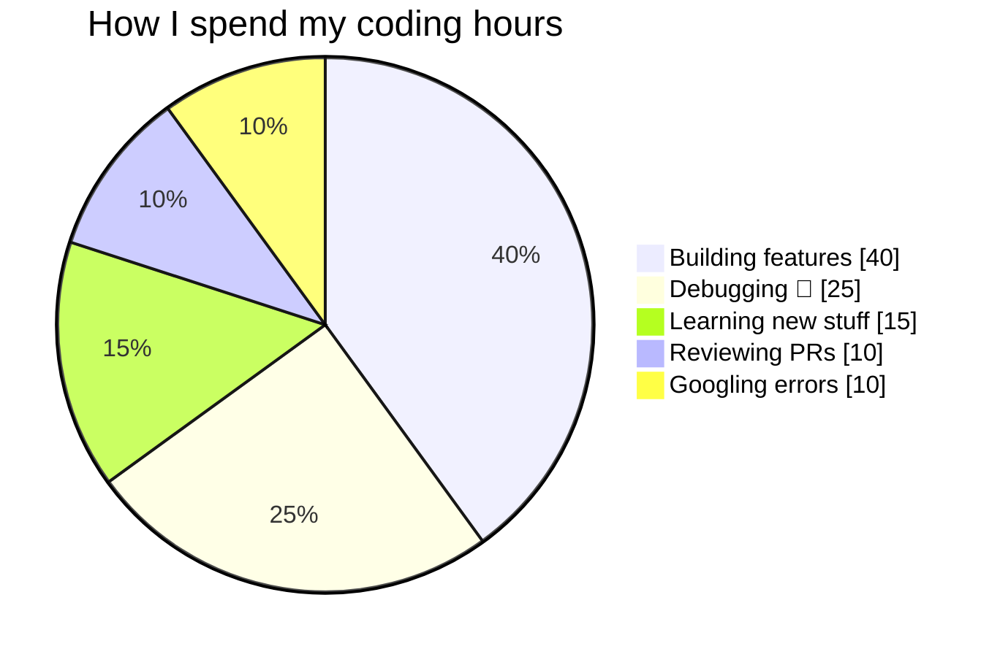

<!-- ======================= HEADER ======================= -->
<p align="center">
  
</p>

<p align="center">
  
  
  
</p>

<p align="center">
  
  
  
</p>

<h3 align="center">✨ I build fast, beautiful & scalable web apps — from pixel to production ✨</h3>

---

## 🧑‍💻 `whoami`

```java
import java.util.HashMap;

public class Siri {
    public static void main(String[] args) {
        HashMap<String, Object> siri = new HashMap<>();

        siri.put("role",        "Full Stack Developer 💻");
        siri.put("location",    "India 🇮🇳");
        siri.put("frontend",    new String[]{"React", "Next.js", "Tailwind CSS", "TypeScript"});
        siri.put("backend",     new String[]{"Node.js", "Express", "Spring Boot", "GraphQL"});
        siri.put("databases",   new String[]{"MongoDB", "MySQL", "PostgreSQL", "Redis"});
        siri.put("devops",      new String[]{"Docker", "AWS", "GitHub Actions", "Vercel"});
        siri.put("learning",    "System Design & GenAI ☁️🤖");
        siri.put("superpower",  "Turning ☕ into clean code");
        siri.put("openToWork",  true);
        siri.put("motto",       "Code. Create. Repeat. ✨");

        System.out.println("Hello World, I'm " + siri.get("role"));
    }
}
```

> 💡 *"First, solve the problem. Then, write the code."* — John Johnson

---

## 🛠️ Tech Arsenal

<p align="center">
  <b>🎨 Frontend</b><br/><br/>
  
</p>

<p align="center">
  <b>⚙️ Backend</b><br/><br/>
  
</p>

<p align="center">
  <b>🗄️ Databases & ☁️ Cloud</b><br/><br/>
  
</p>

<p align="center">
  <b>🧰 Tools</b><br/><br/>
  
</p>

---

## 📈 Skill Meter

```text
React / Next.js    ████████████████████░  95%
Node.js / Express  ██████████████████░░░  88%
MongoDB / SQL      █████████████████░░░░  85%
Java / Spring Boot ███████████████░░░░░░  75%
Docker / AWS       █████████████░░░░░░░░  65%
System Design      ███████████░░░░░░░░░░  55%  📚 leveling up...
```

---

## 🚀 Featured Projects

| | Project | What it does | Built with |
|:-:|:--|:--|:--|
| 🛒 | **ShopSphere** | E-commerce platform with cart, Razorpay payments, order tracking & admin dashboard | React · Node · MongoDB · Redux |
| 💬 | **ChatVerse** | Real-time chat with group rooms, typing indicators & online status | Next.js · Socket.io · Redis |
| 📋 | **TaskFlow** | Kanban project manager with drag-and-drop boards & team roles | React · TS · Spring Boot · PostgreSQL |
| 🤖 | **CodeBuddy AI** | AI assistant that explains code, finds bugs & writes docs | Next.js · OpenAI API · Tailwind |
| 💰 | **ExpenseIQ** | Finance tracker with charts, budgets & monthly PDF reports | MERN · Chart.js · JWT |
| 🎬 | **MovieMate** | Movie discovery with smart recommendations & watchlists | Next.js · TMDB API · Firebase |

<details>
<summary><b>🔍 Click to peek inside ShopSphere's architecture</b></summary>
<br/>



</details>

---

## 🗺️ My Developer Journey



---

## ⏰ A Day in My Dev Life



---

## 🔥 GitHub Streak

<p align="center">
  
</p>

---

## 🏆 Wins & Badges

<p align="center">
  
  
  
  
</p>

---

## 🎯 Currently

| 🔨 Building | 📚 Learning | 🎧 Listening | 🎯 2026 Goal |
|:-:|:-:|:-:|:-:|
| CodeBuddy AI | System Design | Lo-fi beats | Land a dream SDE role 🚀 |

---

## 🤝 Let's Connect

<p align="center">
  <a href="https://linkedin.com/in/your-linkedin"></a>
  <a href="https://instagram.com/your-instagram"></a>
  <a href="mailto:your-email@gmail.com"></a>
  <a href="https://your-portfolio.vercel.app"></a>
  <a href="https://leetcode.com/your-leetcode"></a>
  <a href="https://github.com/siri-developer111"></a>
</p>

<p align="center">
  
</p>

<p align="center"><i>⭐ If you like my work, drop a star on my repos — it makes my day! ⭐</i></p>
